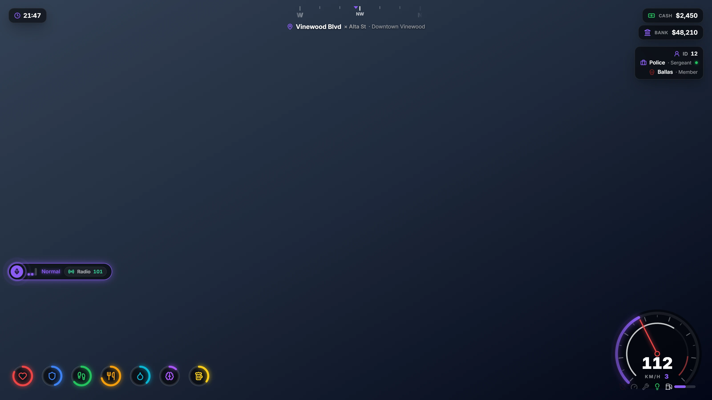
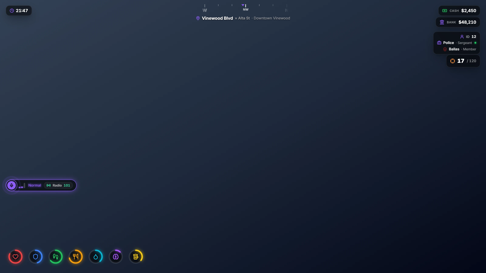
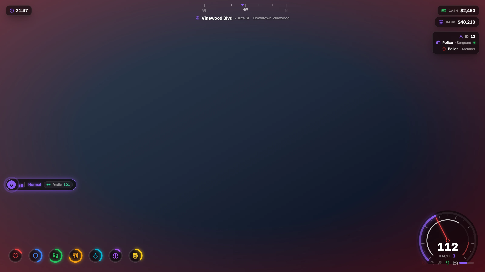
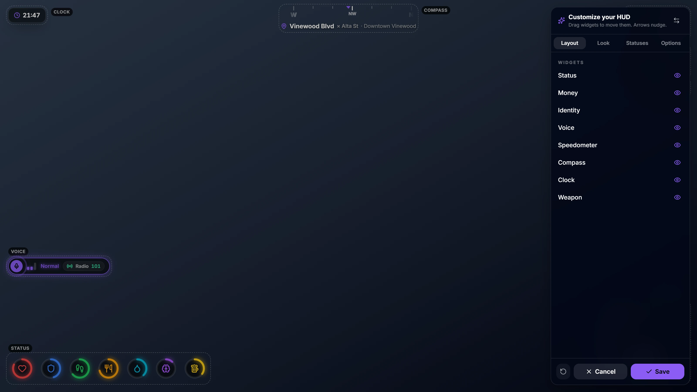

<div align="center">

# ⬢ ug-hud

**The player HUD of the UgCore Framework. Every player drags, restyles and recolors it in game, and keeps it.**

[](https://ugcore.urging.ch/ug-hud/introduction)
[](https://github.com/ugcore-project/ug-hud/actions/workflows/ci.yml)
[](https://github.com/ugcore-project/ug-hud/releases/latest)
[](LICENSE)
[](https://discord.gg/pCJUcyVw5X)

[**Documentation**](https://ugcore.urging.ch/ug-hud/introduction) · [**Installation**](https://ugcore.urging.ch/ug-hud/installation) · [**Player guide**](https://ugcore.urging.ch/ug-hud/players) · [**API**](https://ugcore.urging.ch/ug-hud/api)


</div>

---

ug-hud shows status, needs, money, job, voice, speedometer, compass, clock and weapon. Press `I` or type `/hud` and the editor opens: drag any widget, change its style, size and opacity, pick a preset or any accent color, and save. The layout lives on the player's PC and survives reconnects.

## Features

- 🧩 **Eight widgets, all movable.** Drag with snapping and guide lines, nudge with the arrow keys.
- 🎨 **Presets and colors.** Neon, Minimal, Classic and Sport, any accent color, a style per widget.
- 🏎️ **Speedometer.** Arc with needle and redline, digital or bar. Gear, rpm, fuel, engine, lights, altitude in aircraft.
- 🔒 **Seatbelt and cruise.** Unbuckled players fly through the windscreen in a crash. A chime nags until you buckle up.
- ❤️ **Effects.** Low health vignette and heartbeat, pulsing warnings, money changes that float up.
- 🎬 **Cinematic mode** with letterbox bars, and **smart hide** for full bars.
- 🔗 **Share codes.** Export a layout, import a friend's.
- 🧪 **Custom statuses.** Other resources add bars such as drunk or nitro with one export.

## Preview

| Driving | On foot |
| :---: | :---: |
|  |  |

| Low health | Editor |
| :---: | :---: |
|  |  |

<div align="center">


</div>

## Requirements

- OneSync.
- [ug-core](https://github.com/ugcore-project/ug-core) 1.0.0 or newer. The `needs` and `accounts` modules are optional.
- [ug-lib](https://github.com/ugcore-project/ug-lib) 1.0.0 or newer.

## Installation

Download the latest [release](https://github.com/ugcore-project/ug-hud/releases/latest), extract it to your resources folder and start it after ug-core and ug-lib:

```cfg
ensure oxmysql
ensure ug-core
ensure ug-lib
ensure ug-hud
```

On the first start, `server/config.default.lua` is copied to `config.lua`. Updates never overwrite it. The server console prints `[ug-hud] v1.0.0 ready.` and each client prints `[ug-hud] Ready: neon, /hud to customize.` in F8.

## Usage

```lua
-- Client: a custom status in the status widget.
exports['ug-hud']:AddStatus('drunk', { label = 'Drunk', icon = 'beer', color = '#facc15', value = 0 })
exports['ug-hud']:SetStatus('drunk', 40)
exports['ug-hud']:RemoveStatus('drunk')

-- Client: hide the HUD during your own screen.
exports['ug-hud']:SetHidden(true)
```

Statuses belong to the resource that added them and go away when it stops. See the [API](https://ugcore.urging.ch/ug-hud/api).

## Configuration

`config.lua` sets the defaults new players start from: preset, speed unit, minimap mode and height (`minimapLift`), accounts, voice, fuel source, seatbelt and cruise. Fuel reads the native, an entity statebag (ox_fuel) or a client export (LegacyFuel). See [Configuration](https://ugcore.urging.ch/ug-hud/configuration).

### Look and limits

| Key | Purpose |
| --- | --- |
| `theme` | ug-lib theme overrides for ug-hud only: `mode`, `colors` (HSL per ug-lib token), `radius`, `font`, `scale`. |
| `defaults` | Starting accent (`''` for the preset's), HUD size, 24-hour clock, cinematic, smart hide, effects, sounds, snap. |
| `widgets` | Per widget: `enabled` (`false` removes it for everyone), `visible`, `x`, `y`, `scale`, `opacity`, `style` (`''` for the preset's). |
| `cinematicWidgets` | Widgets that stay in cinematic mode. |
| `statusColors` | Bar colors per status, before players pick their own. |
| `alerts` | Low health, low and high bar levels, statuses where more is worse, heartbeat and chime intervals, chime speed. |
| `editor` | `enabled` (`false` removes the editor, its key and command), offered `presets` and `accents`, and whether players MAY `move`, change `styles` and `colors`, or use `codes`. |

Tables merge onto the defaults field by field, and `widgets` widget by widget, so `widgets = { compass = { enabled = false } }` is enough. Locks hold for old saves and imported codes too.

## Project structure

```text
ug-hud/
├── fxmanifest.lua
├── shared/              enums
├── server/              defaults, config validation
├── client/              NUI bridge, saved settings, statuses, display, vehicle, collectors, editor
├── locales/             en, pt
├── web/                 React page: widgets, effects and the editor
├── tests/               Lua 5.4 tests with native mocks, never shipped
├── skills/              task guides for AI agents, never shipped
├── AGENTS.md            rules for AI agents and humans
└── CLAUDE.md            points Claude Code to AGENTS.md
```

## Development

Clone ug-core and ug-lib next to this repository: the tests and the type check read them from `../ug-core` and `../ug-lib`, or from the `UG_CORE` and `UG_LIB` paths.

Every change MUST pass these checks. CI runs them on pushes and pull requests to `dev` and `main`.

```bash
# 1. LuaLS strict check, zero problems, with ug-core and ug-lib as libraries
lua-language-server --check . --checklevel=Information --configpath=.luarc.json

# 2. Runtime tests
for suite in tests/*.lua; do [ "$suite" = tests/helpers.lua ] || lua5.4 "$suite" || exit 1; done

# 3. Manifest and license headers
lua5.4 .github/scripts/check-repository.lua
```

The page needs Node.js 20.19 or newer:

```bash
cd web
npm ci
npm run lint && npm run typecheck && npm test
npm run build && npm run budget   # web/dist, at most 400 KB gzipped
npm run dev                       # browser preview with buttons that play the showcase scenes
npm run capture                   # README images from the scenes, to .github/assets
```

The README images come from the scenes in `web/src/dev/scenes.ts`: see [skills/readme-preview](skills/readme-preview/SKILL.md).

For editor support, install the [Lua](https://marketplace.visualstudio.com/items?itemName=sumneko.lua) and [CfxLua](https://marketplace.visualstudio.com/items?itemName=overextended.cfxlua-vscode) VS Code extensions.

### Conventions

- Lua 5.4. Every file starts with the license header. Every function has LuaLS annotations.
- The HUD only shows. Needs, money, jobs and death state stay on the server.
- Saved layouts and share codes are untrusted: the page keeps known keys with bounded values. Lua stores at most 32 KB.
- Magic values live in `UgHud.Enums`. NUI enums MUST match `web/src/types/protocol.ts`: `tests/nui.lua` fails when they differ.
- Defaults live in `server/config.default.lua` only, with a comment owners understand.
- Every player-facing text goes through `locales/`. Every locale file has the same keys as `en.json`.

### Working with AI agents

[AGENTS.md](AGENTS.md) holds the conventions and security rules every agent MUST follow. Claude Code reads it through
`CLAUDE.md`; Codex, Cursor and others read `AGENTS.md` directly. Task guides:

| Skill | For |
| --- | --- |
| [nui-page](skills/nui-page/SKILL.md) | The page, its messages and callbacks |
| [config](skills/config/SKILL.md) | Owner config options |
| [testing](skills/testing/SKILL.md) | Lua and web tests |
| [readme-preview](skills/readme-preview/SKILL.md) | README features and images |
| [ug-core-api](skills/ug-core-api/SKILL.md) | What ug-core and ug-lib offer |

### Releases

Releases are automated. release-please keeps a `chore: release X.Y.Z` pull request open on `main` that bumps
`version` in `fxmanifest.lua` and `CHANGELOG.md` from Conventional Commits. Merging it tags `vX.Y.Z`, builds the page
and attaches `ug-hud.zip` with only what a server runs. Every push to `dev` replaces the `dev-build` pre-release.
Merge `dev` into `main` with a merge commit, never squash. Commit subjects become the changelog: write them for owners.

## Contributing

Contributions are welcome. Branch off `dev` and open a pull request to `dev`.

- Commits and PR titles follow [Conventional Commits](https://www.conventionalcommits.org): lowercase imperative subject, no trailing period, 72 characters at most. Scopes: `core`, `api`, `editor`, `widgets`, `vehicle`, `statuses`, `nui`, `web`, `config`, `locale`, `ci`, `deps`.
- Add or extend a test for every change in behavior.
- Translations are welcome: copy `locales/en.json` to your language code and translate the values.

Read the [contributing guide](https://github.com/ugcore-project/.github/blob/main/CONTRIBUTING.md) and the [Code of Conduct](https://github.com/ugcore-project/.github/blob/main/CODE_OF_CONDUCT.md).

## Security

Never report a vulnerability in a public issue. [Report it privately](https://github.com/ugcore-project/ug-hud/security/advisories/new) and read the [Security Policy](https://github.com/ugcore-project/.github/blob/main/SECURITY.md).

## License

ug-hud is free software, licensed under the [GNU General Public License v3.0](LICENSE).

Copyright (C) 2026 UgCore Framework & Contributors.
